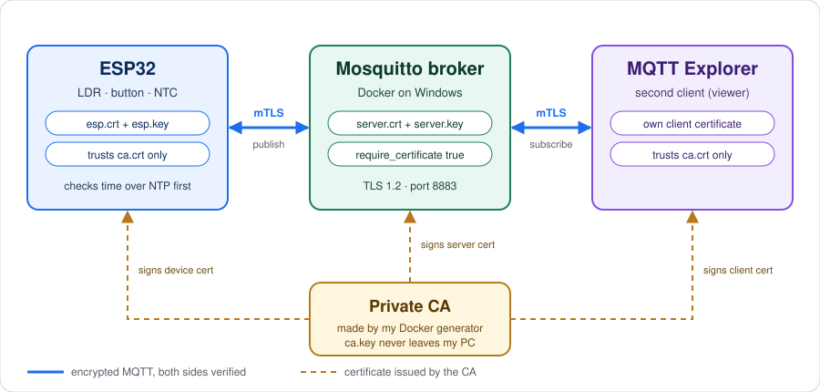

# mqtt-mtls-esp32

**An ESP32 that sends sensor data to an MQTT broker over mutual TLS, using a certificate authority I built myself.**


https://github.com/user-attachments/assets/2507d01a-47b7-41e1-a032-f8a8a0249184


---
Most MQTT tutorials send data in plain text with no authentication, so anyone on the network can read it or publish fake values. This project closes that gap end to end: the broker only talks to devices with the right certificate, and the ESP32 checks the broker certificate before it ever sends a single byte.


---
## Highlights

- **Mutual TLS.** The broker refuses any client without a certificate signed by my CA, and the ESP32 verifies the broker against the same CA.
- **My own certificate authority.** A Dockerized, menu-driven generator creates the CA, server and client certificates, copies each file to the right folder, and checks that every certificate matches the right profile.
- **Reproducible.** The broker and the generator run in Docker, the firmware builds with PlatformIO, and adding a sensor is one line in a text file.
- **Sensible traffic.** A button publishes only when its state changes, and analog sensors publish on a configurable interval.
- **Honest about its limits.** There is a threat model and a list of known gaps in the docs, not just a feature list.

Adding a sensor takes one line in `config.txt`:

```ini
sensor=light,ldr,32,light
```


## The bug that taught me the most

My first generated certificates worked with the broker (OpenSSL) but the ESP32 (mbedTLS) rejected every handshake, while older hand-made certificates worked. The cause was missing X.509 extensions: OpenSSL was lenient, and the ESP32 was strict. I learned how certificate profiles really matter in practice, not just in theory.

## Documentation

| Document | What is in it |
|----------|---------------|
| [docs/SETUP.md](docs/SETUP.md) | How to run the whole system step by step |
| [docs/SECURITY-DESIGN.md](docs/SECURITY-DESIGN.md) | Trust model, certificate profile, threat model, known limitations |
| [docs/LESSONS.md](docs/LESSONS.md) | Problems I ran into and what I learned from each |

## What I would add next

1. **Certificate revocation**, so a lost or stolen device can be cut off before its certificate expires.
2. **Per-device identity and ACLs**, so each device can publish only to its own topics.
3. **Monitoring**, feeding the broker logs into a SIEM to detect refused handshakes and unusual publishers.

## Tech

C++ (Arduino framework) · PlatformIO · ESP32 · LittleFS · MQTT · Mosquitto · OpenSSL · Docker / docker-compose · PowerShell

Tested with Docker Desktop on Windows, Mosquitto 2.1.2, and an ESP32 dev board.

## License


